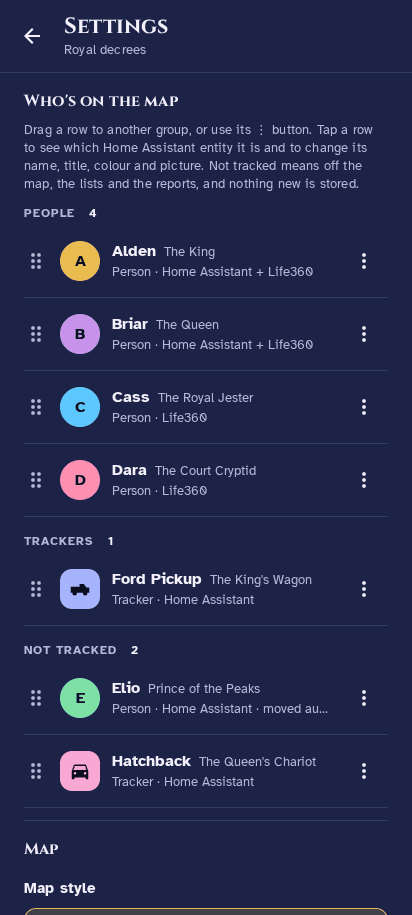

# HA Cartographer for Dummies

## In one minute

HA Cartographer is a family map that lives inside Home Assistant. Open it and you see everyone in your family on a map, like the Life360 app.

- **Where is everyone?** Each person is a little picture on the map. Tap one to see where they are and for how long.
- **Where have they been?** Tap **History** to see their day: every stop and every drive, drawn on the map.
- **How do they drive?** The **Driving** tab shows speeding, phone use and top speed for each driver, week by week.
- **Your stuff stays home.** Everything is saved on your own Home Assistant box, not in someone else's cloud. It's free.

## Before you start

Tick these off first. If one is missing, the app has nothing to show.

- [ ] **Home Assistant with add-ons.** Go to Settings. If you see **Apps** (or **Add-ons**) in the list, you're good.
- [ ] **A normal PC-type computer runs Home Assistant** (Intel or AMD). A Raspberry Pi won't work yet.
- [ ] **At least one phone is being tracked**, either by the Home Assistant app on that phone or by the Life360 integration. Check: Settings → People. If a person shows a location, you're good.
- [ ] **Five spare minutes.**

## Install it

You are telling Home Assistant where to find the app, then installing it like any other add-on.

1. In Home Assistant, open **Settings → Apps** (older versions: **Add-ons**).
2. Press **Add-on store** (bottom right), then the **⋮** menu (top right), then **Repositories**.
3. Paste `https://github.com/Versile2/ha-cartographer` and press **Add**. Close the box.
4. Scroll down the store until you see **HA Cartographer**. Tap it and press **Install**. Wait a minute or two.
5. Want to look before using your real family? Open the **Configuration** tab, switch on **Demo mode** and press **Save**. (Turn it off later the same way.)
6. Back on the **Info** tab: press **Start**, then switch on **Show in sidebar**.
7. A new item called **The Realm** (crown icon) appears in the left sidebar. Click it. That's the app.

## Your first five minutes

The bottom bar has three buttons: **Location**, **Driving** and **Settings**.

1. **Look at the map.** Each circle is a person; a car icon means they're driving. Someone far away shows as a bubble at the edge of the screen. Tap it to fly there.
2. **Open the list.** Tap **Drivers**, **Trackers** or **Places** at the bottom of the map. The list slides up.
3. **Tap a person.** You see where they are, since when, their battery and this week's driving.
4. **Tap History.** You see their day: stops ("At Home · 8:05 am – 5:42 pm") and drives on the map. Use ‹ and › to change the day.
5. **Tap Driving** in the bottom bar. The weekly report shows speeding, phone use and top speed. The printer button makes a PDF.
6. **Tap Settings → Who's on the map.** Drag the truck or a tag into **Trackers**. Drag anything you don't want into **Not tracked**. Tap a row to rename it, pick a colour or an icon.
7. **Need a new place?** In **Places**, tap **+ Add place**, drag the pin, set the size and save. It becomes a real Home Assistant zone.

## Common questions

| Question | Answer |
| --- | --- |
| The map is empty | Is **Demo mode** on? Turn it off for real data. Otherwise check Settings → People in Home Assistant: does anyone have a location? |
| I don't see **The Realm** in the sidebar | Settings → Apps → HA Cartographer → switch on **Show in sidebar**. |
| My car shows up as a person | Settings → Who's on the map → drag it into **Trackers**. |
| History is empty | It fills as the app records. On first start it copies recent days from Home Assistant; older days stay empty. |
| Does it cost anything? | No. It's free and runs on your own machine. |
| Does Life360 see this? | No. Your data stays on your Home Assistant box. |
| How much space does it use? | About 6–20 MB per person per 100 days. Change how long it keeps history in **Configuration** (100–400 days). |
| Something's broken | Settings → About → **Report an issue** opens GitHub. Say what you tapped and what happened. |
