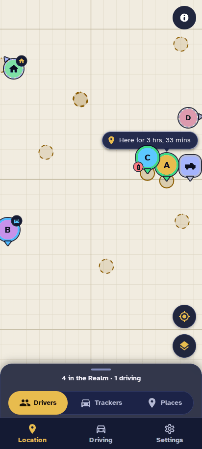
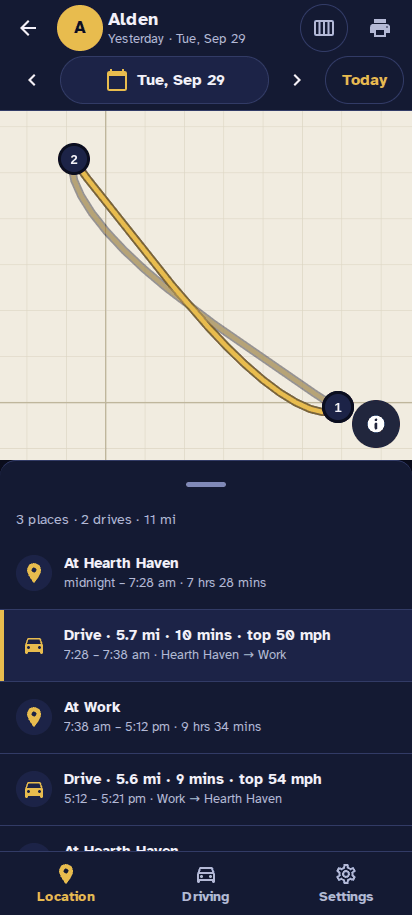

# HA Cartographer — Overview

## What it is

HA Cartographer is a Home Assistant add-on that gives you a Life360-style family map inside Home Assistant: who is where, where they have been, and how they drive. It is built for households that already track phones with the Home Assistant companion app or Home Assistant's Life360 integration and want one good map instead of the built-in one plus a separate app.

It runs on your own Home Assistant box, opens from the sidebar (as "The Realm"), and keeps every position on that box. Current version: 0.3.2, marked experimental.

## What it does

Six screens cover what most families use Life360 for, without the subscription.

| Feature | What you get |
| --- | --- |
| Live map | Full-screen map with a pin per person (their photo or initial) and per tracker, a "Here for 3 hrs" chip, edge bubbles pointing at people off-screen, and four map styles (Night, Day, Streets, Satellite) |
| Bottom sheet / side panel | Drivers, Trackers and Places lists: where each person is, since when, battery, how fresh the location is; tap for details |
| Location History | Per person or tracker, one day at a time: the trail on the map, every stop ("At Home · 8:05 am – 5:42 pm"), every drive ("12.4 mi · 24 mins · top 71 mph"), a 7-day view, print to PDF |
| Driving report | Weekly speeding, phone use, top speed, drives and miles per driver; last month / 3 / 6 / 12 months or a custom range; every event listed with a pager; print to PDF |
| Places | Your Home Assistant zones, exactly as Home Assistant has them; **+ Add place** creates a new Home Assistant zone by dragging a pin and radius |
| Who's on the map | Settings lists every person and GPS tracker Home Assistant and Life360 know; drag each to People, Trackers or Not tracked; rename, recolour or change its icon; a Home Assistant notification when a tracker appears or goes quiet |

 

## How it works

The add-on reads what Home Assistant already knows; it adds no cloud service and needs no extra accounts.

1. **Sources.** Home Assistant `person` entities, GPS `device_tracker` entities (companion app, car integrations, anything with latitude/longitude) and members from Home Assistant's Life360 integration.
2. **Discovery.** On first start it adds everyone and every GPS tracker with data in the last 30 days, and back-fills recent history from Home Assistant's recorder. New trackers are added later with a notification; trackers gone or disabled for 7 days move to Not tracked.
3. **Storage.** Positions go into a small SQLite database in the add-on's own `/data` folder, kept for 100 days by default (up to 400; roughly 6–20 MB per person per 100 days). Not tracked entries store nothing.
4. **Derived views.** Drives come from the stored positions (Life360 drive flags when present); stops are worked out when you open History; zone names come straight from Home Assistant.
5. **Display.** The app is a Blazor web app served through Home Assistant Ingress, so it opens inside Home Assistant (desktop, phone browser or the companion app) with your normal Home Assistant login. Maps are MapLibre with OpenFreeMap/OpenStreetMap tiles; satellite imagery is from USGS.

**Privacy:** location data never leaves your Home Assistant box. The only outside requests are map tiles.

## Why try it

It sits between Home Assistant's map, which shows only where people are now, and the Life360 app, which keeps your history and reports on its own servers behind a subscription.

| | Home Assistant map | Life360 app | HA Cartographer |
| --- | --- | --- | --- |
| Live family map | Yes | Yes | Yes, with photos, "here for" times and off-screen bubbles |
| Location history with stops and drives | Recorder data only, no timeline | Yes (paid tiers for longer) | Yes, 100–400 days, printable |
| Weekly driving report | No | Yes (paid) | Yes: speeding, phone use, top speed, any date range |
| Trackers (car, tag, tablet) on the same map | Yes | Limited | Yes, with their own history |
| Uses your Home Assistant zones | Yes | No (own places) | Yes; can create new zones |
| Where your data lives | Your box | Life360's cloud | Your box |

It is also built to be easy on a phone: one-tap sheet, 48 px touch targets, screen-reader labels and a Demo mode to try it with a fictional family before pointing it at real data.

## Requirements, install and status

**Needs:** Home Assistant OS or Supervised (add-ons), an amd64 (x86-64) machine, and at least one tracked phone (companion app or the Life360 integration). Raspberry Pi / ARM is not built yet.

1. Settings → Apps (Add-ons) → Add-on store → ⋮ → **Repositories**, add `https://github.com/Versile2/ha-cartographer`.
2. Find **HA Cartographer** in the store and press **Install**.
3. Optional: in **Configuration**, turn on **Demo mode** to look around with a fictional family first.
4. Press **Start**, turn on **Show in sidebar**, then open **The Realm** from the sidebar.
5. In the app, open **Settings → Who's on the map** to sort people and trackers.

The add-on has seven options: Demo mode, Allow demo link, Show Add buttons, Log level, Driving week start, Speeding threshold, and history length (100–400 days).

**Status:** experimental, released through GitHub with automatic builds; every change runs about 3,000 automated tests plus browser tests. Bugs and ideas: [GitHub issues](https://github.com/Versile2/ha-cartographer/issues). Not affiliated with Life360, Nabu Casa or the Open Home Foundation.

See also: [Getting started (plain-language guide)](GETTING-STARTED.md) · [Releases and changelog](https://github.com/Versile2/ha-cartographer/releases)
